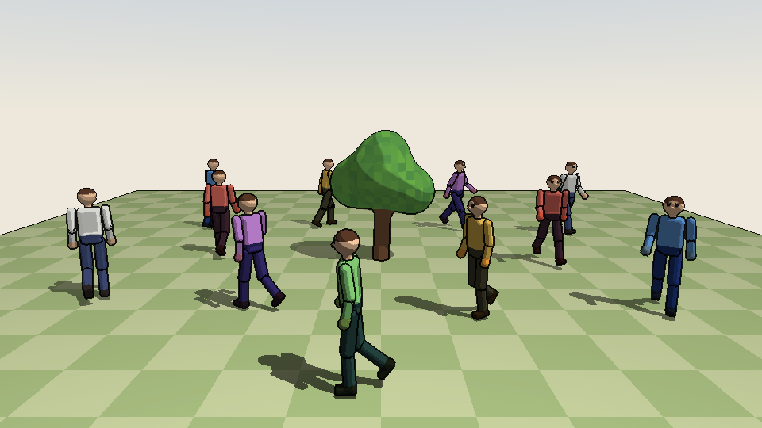
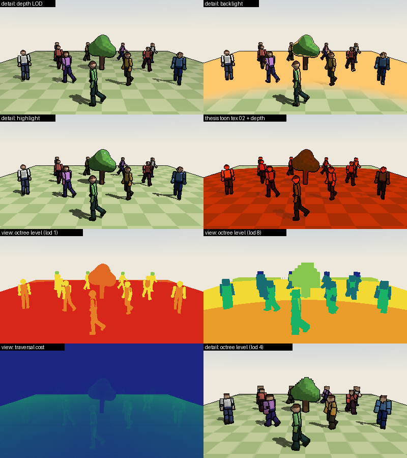

# X-Toon Sparse Voxel Octrees

A rebuild of my 2016 thesis project with the goal it set out with: **animating
sparse voxel octrees**, shaded with the extended toon shader (X-Toon).



The original `VolRender/` project was a dense 256³ 3D-texture ray caster with
X-Toon shading. This version replaces the dense grid with sparse voxel octrees
(SVOs) and adds animation, while keeping X-Toon (with the original's shading bugs
fixed) and the thesis data sets and toon textures.

- **Sparse voxel octrees** built from SDF shapes or raw 8-bit volumes (your
  `bonsai.raw`, `head.raw` and `male.raw` load as-is). Empty space is skipped one
  octree cell at a time, and each node stores a prefiltered colour and normal.
- **Level of detail**: traversal stops once a cell is smaller than a pixel.
  Distant objects cost less and don't alias.
- **Animation with rigid parts plus a top-level BVH**: every limb is a static
  octree with a keyframed transform. A BVH over the instances is rebuilt every
  frame, and rays are transformed into each instance's voxel space.
  All 12 walkers share 6 limb octrees.
- **X-Toon** (Barla, Thollot & Markosian, NPAR 2006) with detail by depth, focus,
  backlight and highlight, plus a new mode tied to the octree's LOD level.
- **The same renderer twice**: an OpenGL 4.5 compute shader for interactive use,
  and a line-by-line C++ port used for tests, headless rendering and
  checking the GPU output.

## Building (Linux)

```sh
sudo apt install build-essential cmake ninja-build libgl-dev libglfw3-dev libglm-dev
cmake -S svo -B svo/build -G Ninja
cmake --build svo/build
./svo/build/svo_tests          # unit tests
./svo/build/xtoon_svo          # interactive viewer
```

If GLFW or glm isn't installed, CMake downloads it. Building GLFW from source also
needs `libx11-dev libxrandr-dev libxinerama-dev libxcursor-dev libxi-dev libwayland-dev libxkbcommon-dev`.
Dear ImGui is always downloaded, and the GL loader (glad) is vendored in `third_party/`.
The viewer needs OpenGL 4.5; check yours with `glxinfo -B`. Any NVIDIA or AMD driver
from the last ten years works, as do recent Intel/Mesa drivers.

## Running

```sh
# Default scene: 12 walkers around a procedural tree
./svo/build/xtoon_svo

# Use the thesis bonsai as the centrepiece (path:WxHxD:isoThreshold)
./svo/build/xtoon_svo --volume VolRender/bonsai.raw:256x256x256:40 --walkers 40

# Headless, CPU only: write PNGs, or an animation sequence
./svo/build/svo_cli --out frame.png --size 1280x720 --time 2.5
./svo/build/svo_cli --out walk.png --frames 48 --fps 24 --detail 3 --toon backlight
```

Run either program with `--help` to see every option. The three thesis volumes are
`bonsai.raw` 256×256×256, `head.raw` 256×256×225 and `male.raw` 256×256×128.
The original loader assumed 256³ for all three, so two of them were padded with zeros.

**Viewer controls:** left-drag to orbit, right-drag to pan, wheel to zoom, Space to
play/pause, R to hot-reload shaders, F12 for a screenshot, Esc to quit. The panel
switches views (X-Toon, albedo, normals, octree level, traversal cost, detail D),
X-Toon modes and toon textures (including the four thesis textures).



## How it works

### Octree layout (`src/core/octree.*`)

Each node is 16 bytes and goes to the GPU unchanged:

| field | meaning |
|---|---|
| `childBase` | index of the first child |
| `childMask` | 8 bits, one per occupied octant; 0 means leaf |
| `color` | RGBA8 average of the subtree |
| `normal` | octahedral-encoded average normal |

Only occupied children are stored, contiguously, so child `i` is at
`childBase + popcount(childMask & ((1 << i) - 1))`. The builder Morton-sorts the
occupied voxels and merges siblings bottom-up, so it never allocates a dense
pyramid. The tree is stored breadth-first. With `shellOnly`, voxels that can't be
seen from outside are dropped before building. That removes most of the interior
of solid shapes.

### Traversal (`src/core/traverse.cpp`, `shaders/svo.glsl`)

The traversal is a hierarchical DDA over integer cell coordinates:

1. Descend while the octant under the current cell is occupied.
2. When an octant is empty, skip that whole cell in one step.
3. Pop back up only as far as the step crossed. That level comes from the highest
   differing bit of the old and new coordinates, so there's no restart from the root.

The stack holds node indices only. Cell positions come from the integer
coordinates, which avoids the float-precision tricks in Laine & Karras.
The tests check that this matches a brute-force voxel DDA exactly on 16,000 random rays.

### Level of detail

A cell of `s` voxels at distance `t` is accepted as a hit once
`s ≤ lodBias · pixelSpread · t / voxelSize`, i.e. once it covers less than a pixel.
Interior nodes store averaged colours and normals, so this is
prefiltering rather than just stopping early. In the "octree level" view, distant
walkers render 1–3 levels above their leaves.

### Animation (`src/core/animation.*`, `bvh.*`, `scene.*`, `demo.*`)

Octrees are expensive to rebuild and cheap to transform, so animation moves rigid
octrees rather than voxels:

1. A keyframed skeleton (slerp, looping) poses every joint.
2. Each limb instance gets `voxelToWorld = walkerRoot · joint · voxelToObject`.
3. A binned-SAH BVH is built over the instances' world bounds every frame.
   Posing plus the BVH build takes 0.16 ms for the default 122 instances and
   about 2.7 ms for 2,000 (measured on one CPU core).
4. The ray goes through the BVH, then into each candidate's voxel space via the
   inverse affine transform, *without renormalising the direction*. So `t` stays
   in world units, and hits from different instances compare directly.

This is the same structure as a ray-tracing TLAS/BLAS, with octrees as the BLASes.
Instancing comes for free: the crowd shares 6 limb octrees (791k nodes and
12.7 MB for the whole default scene).

### X-Toon (`src/core/xtoon.h`)

The toon texture is indexed by `(max(n·l, 0), D)`. The detail functions follow
the paper and fix the problems found in the 2016 shaders:

| | 2016 `rayCastXToon.frag` | now |
|---|---|---|
| depth LOD | `log(zMax - zMin)` (subtraction), divides by zero at the default `r = 1` | `1 - log(z/zMin)/log(r)`, with `r` clamped above 1 and the result clamped to [0,1] |
| backlight | `pow(n·v, r)`, NaN for back-facing normals | `pow(abs(n·v), r)` as in the paper |
| normals | `abs()` on every gradient term, so all normals sat in one octant | signed gradient, negated to point outwards |
| `n·l` | dot with the light *position* (5, 5, 30) | dot with a unit light direction |
| texture wrap | `GL_REPEAT` turned out-of-range values into bands | `GL_CLAMP_TO_EDGE` |

The new **octree-level** mode sets `D = level / depth`, so the abstraction follows
the octree's own LOD: coarser cells are shaded more abstractly.

Texture alpha decides how much the voxel's own colour tints the toon tone. Rim and
highlight texels use alpha 0, so they keep their own colour.

## Verifying changes

- `svo_tests` covers octree build invariants, traversal against brute force,
  LOD monotonicity, BVH against brute force, instanced scene hits in world units,
  keyframe interpolation and wrap-around, X-Toon ranges (no NaN/Inf) and texture
  loading.
- `xtoon_svo --screenshot out.png --compare --hidden` renders one frame on the GPU and
  on the CPU and reports how many pixels differ. On Mesa llvmpipe it reports 0.001%
  of pixels differing by more than 24/255. Run it after editing the shaders.

## Where to go next

- **Bricks instead of single-voxel leaves** (GigaVoxels): store N³ bricks in a 3D
  texture at the leaves, for hardware-filtered sampling and smoother surfaces up close.
- **Contours and beam optimisation** (Laine & Karras 2010): tighter surfaces
  per node, and a coarse pre-pass so each pixel's ray starts near its first hit.
- **Deformation inside a part**: bend rays through inverse skinning, or rebuild
  just the parts that deform (GPU voxelisation, Crassin & Green 2012).
- **Compression**: sparse voxel DAGs (Kämpe et al. 2013) merge identical subtrees.
  That suits the many repeated limbs here.
- **Temporal reprojection**: reuse last frame's hits to cut primary-ray cost.
